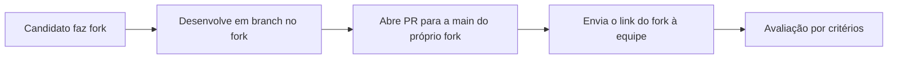

Este repositório é o **enunciado** de um desafio técnico para trainee fullstack. Não é um sistema:
não tem código, banco, deploy nem pipeline. O candidato faz um fork e constrói, no fork dele, um
Analisador de Documentos com Node.js, React e PostgreSQL.

## O que há no repositório

| Caminho | Para que serve |
|---|---|
| [README.md](../README.md) | O enunciado completo: instruções, requisitos, regras do analisador, critérios de avaliação e diferenciais. |
| [exemplos/](../exemplos/README.md) | Seis documentos fictícios (`.txt`) e a saída esperada de cada um (`.esperado.json`). |

O README é o enunciado e **não** segue o modelo de README de sistema da organização, de propósito:
o candidato o substitui pelo README da solução dele.

## Como o desafio funciona

- A solução fica no fork do candidato. Este repositório não recebe PR de candidato.
- O histórico de commits do fork também é avaliado.
- Dúvidas gerais vão para as Discussions do repositório, para que a resposta sirva a todos.
- Só dados fictícios: os exemplos e a solução não podem ter documento real nem dado pessoal.

## O analisador em uma frase

O analisador por regras recebe o texto de um documento e devolve `tipo`, `resumo` e
`pontos_de_atencao`. As regras estão no [README](../README.md) (Módulo: Análise) e os seis casos
em [exemplos/](../exemplos/README.md). O teste obrigatório do candidato é reproduzir exatamente
essas seis saídas. O sexto exemplo reúne casos de borda (quebras de linha, normalização Unicode,
emojis, espaços especiais).

## O que não existe aqui

- Código-fonte, Dockerfile, workflows e ambiente de produção.
- Gabarito de uma solução completa: só as saídas esperadas do analisador.
- Tutoriais, guias de deploy, referência de API ou banco: o enunciado já define esses contratos
  e quem implementa é o candidato, no fork.

## Estado

Ficha em [catalogo.yml](catalogo.yml): status `parado`. O prazo do ciclo de 2026 encerrou em
14/10/2026 e o único commit é de 06/10/2026.
